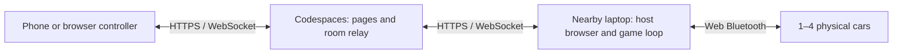

# Codespaces server, nearby Bluetooth laptop, phone controllers



The browser on the nearby laptop owns all Bluetooth connections. The server does
not connect to the cars, and phones do not need Web Bluetooth. Human and computer
drivers share the same host control loop. The laptop can also be a human player.
Use Chrome or Edge with Web Bluetooth support on that laptop. Keep its host tab
visible, its lid open, and sleep disabled for the supervised session. Remote
latency affects phone inputs; rendering and the control loop share the host browser main thread.

## GitHub Codespaces

1. Open this branch in a Codespace using the supplied `.devcontainer` configuration.
   It installs the locked Node dependencies without install scripts.
2. The configured devcontainer runs `npm run slipstream:up` on start. You can also
   run `PORT=3000 npm run slipstream:up` manually. It starts the live-only server in
   the background or verifies that the managed server is already running. Retrieve
   the operator's private host code with `cat ~/.local/state/slipstream-managed/host-code`.
   Keep that code private; it authorizes room creation.
3. Open the forwarded port 3000 URL, appending `/slipstream/`, on the nearby laptop.
   Use the browser-facing **HTTPS** URL, normally
   `https://CODESPACENAME-3000.app.github.dev/slipstream/`. The upstream server is
   plain HTTP: leave the forwarded port's **protocol** set to HTTP.
4. Connect cars on that laptop, or choose the two-car simulation first. Enter the
   saved host code in Remote players and create a room. Approve players before
   assigning them to cars. Each car's Code button provides its phone join link.
5. Open those links on the phones. Forwarded ports are private by default;
   GitHub's authentication/organization rules still apply before the app loads.
   For a public QR session, explicitly set port **3000** to **Public** in Ports.
   The `slipstream:live` command excludes the course bench, mock APIs and instructor
   drive routes; use it for this setup. Keep the forwarding protocol **HTTP**;
   the external browser URL remains **HTTPS**. Do not put GitHub tokens
   in join links. App join credentials do not bypass GitHub's access gate.

Codespace stop/rebuild or server restart destroys in-memory rooms. Create a fresh
room and rejoin; do not expect continuity. Printed status messages do not guarantee
Codespace uptime. Verify an approved phone can join, send inputs and reconnect
through the actual classroom network before operating physical cars.

## Standalone Docker

```sh
docker compose up --build
```

Open `http://127.0.0.1:3000/slipstream/` locally. The image runs as the unprivileged
`node` user. Compose publishes only to the Docker host's loopback interface;
phones cannot reach that address from another device. For remote phones, provide
an HTTPS reverse proxy or authorized port forward with WebSocket and streaming
response support. Use the resulting HTTPS address for the host page too, so the
join links have the right origin. Do not expose the plain HTTP port directly.

`--container` explicitly binds the process to `0.0.0.0` inside the container and
requires `--slipstream`. Normal starts remain loopback-only. The game assets use
same-origin dependencies, including pinned Three.js; no graphics CDN is required.

## Presentation and physical limits

The host has adjustable desktop panel widths, responsive stacked layouts, and
an optional 3D studio. Phones use the lighter dedicated controller with optional
haptics and tilt when supported and enabled. Haptics are supplemental: visual
feedback remains necessary on browsers that do not implement vibration.

The 3D studio is an original procedural visualization, not the Unity game or a
measured 3D digital twin. Elevation and occlusion at crossings cannot be inferred
reliably from the current telemetry. Circuit planning does not certify a physical
track. Treat stale or inferred positions accordingly.

Phone loss is handled by existing stale-input stops. A dead host browser cannot
send STOP: a car-enforced host-loss timeout remains unverified. Keep physical
supervision and a way to retrieve cars during initial hardware validation.

Verified locally: Docker build, non-root process, HTTP assets, browser rendering,
and automated relay tests. Actual Codespaces forwarding, phone sensors, and
Bluetooth hardware remain to be tested in the target environment.

References: [GitHub port forwarding](https://docs.github.com/en/codespaces/developing-in-a-codespace/forwarding-ports-in-your-codespace),
[Chrome Web Bluetooth](https://developer.chrome.com/docs/capabilities/bluetooth),
[Three.js](https://threejs.org/docs/).

## Repeatable startup and recovery

`slipstream:up` requires Node 22 or newer. It stores the host code, startup identity,
PID and log under `~/.local/state/slipstream-managed/` (directory owner-only; files
owner read/write). `SLIPSTREAM_STATE_DIR` overrides that directory. A supplied
`SLIPSTREAM_HOST_CODE` must match an already-running managed server. The code
persists across process restarts; rooms and player approvals do not.

The launcher refuses an occupied port belonging to an unmanaged server. It never
stops that server, takes over its rooms, or changes port visibility. Existing
foreground deployments can keep using `npm run slipstream:live`; migrate only
between sessions after stopping that process deliberately. If startup was
interrupted and left `startup.lock`, inspect its PID and confirm no startup is
active before removing the lock. Do not delete server state during play.

`/slipstream/ready` is a minimal, uncached readiness response with a non-secret boot
identity. It is not proof of Bluetooth, phone connectivity, telemetry or safe
physical stopping. After Codespace restart, verify public forwarding again and
create a fresh room. A public URL does not itself authorize a player to drive.

## Check the public relay without cars

Run `npm run slipstream:check` with `SLIPSTREAM_CHECK_ORIGIN` set to your public
HTTPS origin and `SLIPSTREAM_HOST_CODE` supplied privately. For managed startup:

```sh
SLIPSTREAM_HOST_CODE="$(cat ~/.local/state/slipstream-managed/host-code)" \
SLIPSTREAM_CHECK_ORIGIN="https://YOUR-CODESPACE-3000.app.github.dev" \
npm run slipstream:check
```

This diagnostic opens its own temporary room for each transport, approves four
test players, sends neutral input, checks individual state delivery and revoked
credentials, then deletes its rooms. It never attaches Bluetooth, uses an existing
room, or publishes a moving-car state. The check exercises the production network
client over WebSocket and forced HTTP fallback. Use it before inviting players or
after changing networks. A passing result is not proof of browser compatibility,
sensor operation, classroom latency or car control. Do not include the host code
in screenshots or public reports.

On 12 November 2026 both transports passed through the actual public Codespaces
HTTPS endpoint from within the Codespace, with four clients each. A phone outside
that network still requires acceptance testing. GitHub PR checks currently show
no runs; recorded local/Codespaces test results must not be described as CI results.
