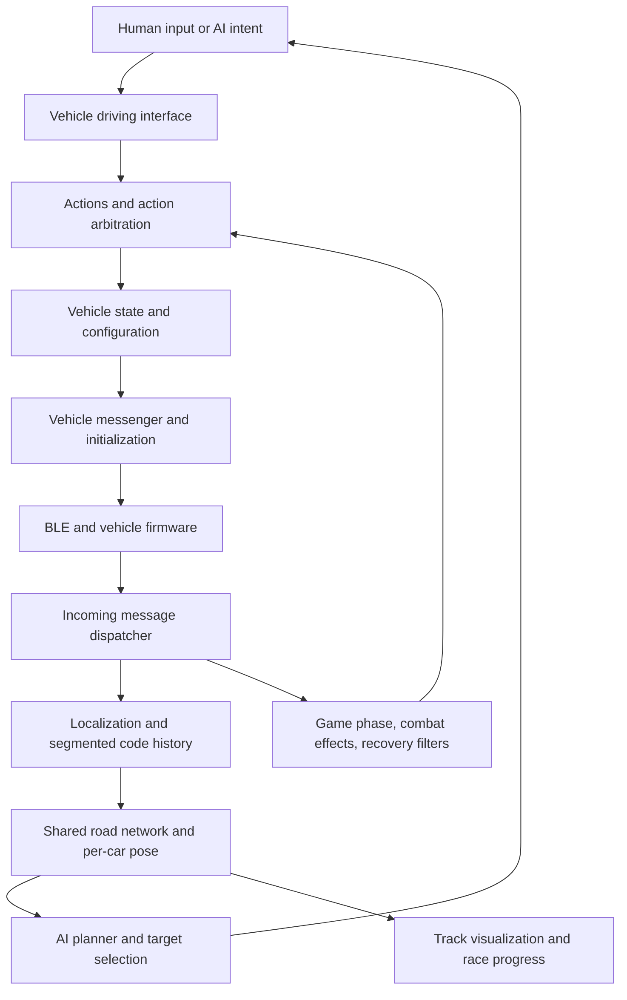
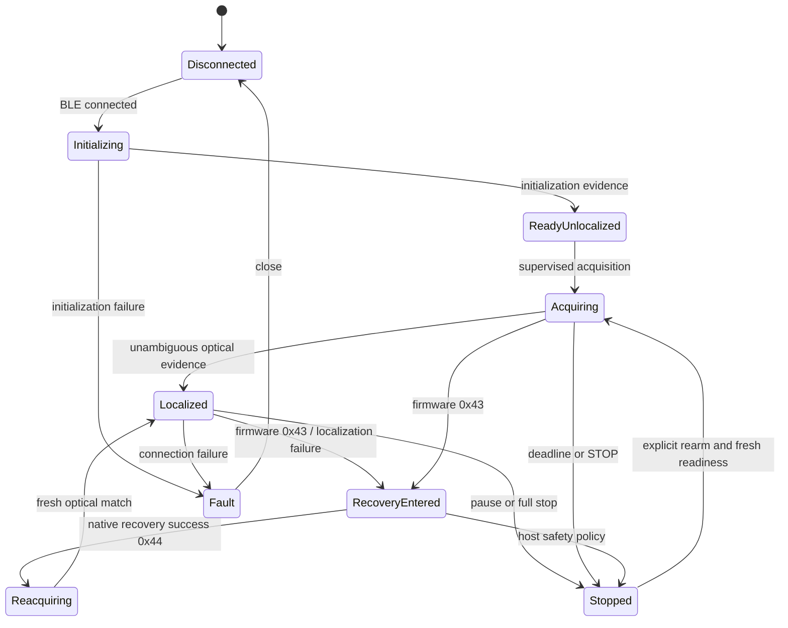

# Original F&F app: reconstructed state machines and feature map

13 November 2026. Review of retained F&F build403 native library and configuration, official SDK, existing exports, three independent AI reviews, and a fresh read-only Ghidra lifecycle export. This is an interoperability architecture review, not the original source tree or a complete recovery of every feature. No app/firmware was executed. No car commands or new firmware settings were sent.

## Evidence levels and limits

**Inspected:** meaningful function bodies/configuration and their callers were read. **Inventory:** symbols/configuration establish that a subsystem exists, but do not establish its complete semantics. **Physical:** requires a trace and operator observation; neither decompilation nor simulation substitutes for it.

Fresh export: 35 selected functions including thunks, zero decompiler failures. Script: `tools/ExportVehicleLifecycle.java`; reproducibility manifest: `VEHICLE-LIFECYCLE-COVERAGE.json`. Raw proprietary decompilation stays outside the repository. Existing inventory reports443+656 exported entries, not unique whole-app coverage. ARM floating-point calling convention recovery, unresolved virtual calls and jump tables remain material limitations. The conceptual state names below are our reconstruction, not recovered enum names.

## 1. Control architecture

The app does not simply relay a throttle slider. `VehicleDrivingInterface::RequestSpeed`007c8740 selects acceleration/deceleration from vehicle configuration when unspecified, stores intended speed, and passes it onward. `ActionArbiter::ExecuteAction`007c0854 updates filters before checking/executing an action. `Vehicle::ChangeSpeed`007a8900 checks messaging/state constraints, updates vehicle state, sends a speed command, and conditionally cancels or reissues lane intent. Floating-point constants/arguments in this decompilation must not be copied without assembly/config corroboration.

Our Game/Car/Battle split is simpler. It has important deliberate safeguards (neutral arming, shared pit, STOP priority), but it does not reproduce native action arbitration or all firmware-lifecycle transitions. Retain our safety rules while adding explicit state and evidence distinctions.

## 2. Vehicle lifecycle and firmware recovery

This diagram separates reconstructed native behavior from recommended Slipstream gates. In particular, **our 0x44 handler must not automatically resume**. Native `ExecuteLastDrivingIntention`007a975c invokes the driving component for a non-AI player; exact virtual target remains unresolved.

| Native transition | Verified call/context | Wire meaning / implication |
| --- | --- | --- |
| Enter game pause | EnterGamePauseState007a9b94, conditional on vehicle state | Stop items/effects/control, send SkipAutoDriveInDeloc(true), process delocalization and set local flags |
| Exit game pause | ExitGamePauseState007a9c04 | Clear flags, send false, process delocalization, re-enable controls; additional speed/action logic is conditional |
| Enter full stop | EnterFullStopState007a9ce8 | Change speed, send true, process delocalization, mark full stop |
| Exit full stop | ExitFullStopState007a9d28 | Send false, clear state; logs misuse if not previously stopped |
| SDK driving begins | SdkVehicleController::StartDriving00799ca4; SdkDrivingScript::StartDriving0082deae | Enable speed commands and explicitly send false |
| Track detection begins | VehicleManager::BeginTrackDetection007b24b0 | For eligible vehicles, send false, request speed, raise track-scan event and record start time |
| Controls disabled/enabled | GameLogicGamePhase006e970e/006e973c | Conditional boolean selects whether to send true/false; stopping items is also separate |
| Recovery entered/succeeded | VehicleMessenger::ProcessIncomingMessage007b5310, cases0x43/0x44 | Enable/disable recovery action filter; success calls ExecuteLastDrivingIntention |

`CarMsgSkipAutoDriveInDeloc`006ac6ec/006ac76c encodes size2,id0x35,boolean: `02 35 01` or `02 35 00`. Its layout and native use are established; its exact effect on firmware11866 in our operating mode is not hardware-verified. Slipstream currently sends neither packet. This is a lifecycle gap and an experiment candidate, **not permission to send a new firmware command** or evidence that it caused the spin-off. Changes would need an explicit policy for initialization, every stop, disconnect, recovery and rearm; preserve STOP priority and never copy native automatic resume by accident.

`EnableDelocAutoRecoveryFilter`007b50cc adds/removes an ActionArbiter filter and configures speed/control limits. Exact float values remain uncertain. The app's handling of firmware recovery is more than merely changing an icon.

## 3. Track discovery and localization are separate systems

| Responsibility | Inspected native symbols | Our implementation / acceptance gap |
| --- | --- | --- |
| Initialization/default road context | VehicleInitSequence007aff3c/007b0080 | F&F subset and separate SDK path; pongs prove replies, not all semantic acceptance |
| Per-car segmented optical history | TrackMapper0089ee44/0089ee5c/0089ee78 | One selected scanner and simpler ordered sequence; no equivalent multi-car history reconciliation |
| Encoder/hill/jump evidence | UpdateLatestEntryEncoders0089f110; Hills0089f0f0; HandleJumpLaunch0089f130; FakeJumpCounterpart0089eec8 | Coarse encoder inference and flat geometry; elevation/jump counterpart semantics incomplete |
| Build/merge map candidates | BuildRoadNetworkDefWithMasterHistory0089c6b8; WithStringMatching0089eb34 | Native merges contiguous histories and loop matches; our repetition/geometry closure is a constrained approximation |
| Validate map | CheckForTrackErrors0089e2b8; CheckMapHasAllPieces0089c248 | Native distinguishes missing start, multiple starts, backward jump. Our no-start preview support is deliberate; race validation needs explicit policy |
| Accept and visualize topology | BuildNetwork0089f2d4; UpdateAllWorldVizFromTopology0089fa2c; OnTrackDiscoverySuccess0089e7d4 | Candidate/observed/accepted maps should be distinct. Geometry closure alone is not full topology proof |
| Match each car to shared map | ProcessPositionUpdate0071bdc0; FindUniqueBiDirectionalMatch...008773e4 | Our candidate index/direction filtering lacks native history/encoder matching; ambiguous cars must remain unlocated |
| Transition/intersection handling | ProcessTransitionBarUpdate0071c660; ProcessIntersectionPositionUpdate0071cd10; ExpectedPieceIdx0071d60c | Intersection packets decode, but our Localizer does not implement their native traversal logic |
| Wrong track and poor sensing | IsVehicleOnWrongTrack00719bb4; CheckBSDelocalizationThreshold0071e358; CheckForUnexpectedSlowdown0071dda4 | Native combines timing, slowdown, encoder mismatch and dirty-tire detection. Our 5s/2s watchdog does not identify these causes |
| Delocalization reset | ProcessDelocalizationUpdate0071e178 | Native resets lane/localization state, starts a history segment and may queue LocalizeAction. Our shared-pit stop is deliberate; stale reference confidence still needs explicit invalidation |

A saved map says what a circuit looked like previously. It does not locate a newly connected car, prove the circuit is unchanged, or authorize scoring. Proposed host model: map candidate → geometrically consistent → operator observed → race eligible, with per-car localization tracked independently.

## 4. Vehicle-specific dynamics

Inspected vehicleTypes.json: Groundshock8 inherits base_car99. Its normal min/default starting speed is0.34m/s, acceleration1.0m/s²; lane speed0.99m/s with legacy0.3. trucks_base102 has min/default0.34, acceleration0.15, lane speed0.22. Model-specific overrides/inheritance must be resolved before reuse; these values are app configuration, not proven firmware hard limits or safety recommendations.

The150/240mm/s experiments are below that configured normal regime. Do not raise our ceiling based on this alone. At ideal acceleration1000mm/s², a150mm/s request for500ms travels only about63.75mm from rest. Therefore the diagnostic is a **command/STOP probe**, not a reliable localization test unless placement relative to a known optical code is controlled. The successful scan's first position arrived1627ms after a300mm/s request. Absence of a code during a short pulse cannot by itself falsify initialization.

## 5. Other vehicles, races and attacks

The architectural evidence supports host-side shared-road geometry, per-car localized state and game/AI controllers for interactions. It does not establish direct peer-to-peer car associations or cooperative firmware networking. Slipstream's teams/targets must remain host decisions derived from sufficiently fresh, unambiguous poses. Never infer physical proximity from car IDs or similar piece IDs on repeated sections.

Our battle engine supplies crews, associations, targeting shapes, energy, shields, cooldowns, disables, mines and speed/lane/light effects; the original app's action-filter, death/grace and recovery ordering is richer. Available data tables do not prove behavioral parity. Power Zone has a dedicated attack/eligibility path; reading piece57 does not prove activation or justify a speed boost. It remains quarantined for scored use pending evidence.

New software-only finding from the multi-car reviewer: rear-facing cone targeters with negative length are impossible under our positive-gap cone condition. ShredderShotgunL01 and X52IceShredderShotgunL01 have negative length. Document and reproduce target direction/angle/anchor semantics before changing gameplay; this is separate from localization/steering failures.

### Multi-car and Power Zone event lifecycle

Native BasestationContext resolves VehicleId to vehicle objects and LocalizationAPI supplies their poses. RoadNetworkDefBuilder::Build00894b38 validates intersection entry/exit consistency and sanitizes graph connections. ZoneFxItems::GetItemPose008a1d80 computes a zone pose from a **road-piece instance index**, drivable section and region; printed piece ID alone is insufficient.

The inspected zone chain is:

`HandleZoneFxSupercode008a2a84 → source eligibility/trigger state → ZoneFxZoneAction::Trigger008a37ec → GetTargets008a2100 → ZoneFxAction_Disable::Trigger008a3a5c → team/hack eligibility → damage/scripts/attribution/playback`.

Separate state exists for source triggered/not-triggered, zone action cooldown, and target immunity. ResetZoneTrigger008a2a74 exists, but full reset timing is unresolved. Configuration specifies1s cooldown and3s invulnerability. ZFXDisable uses a zone-centered rectangle of length0.56m/half-width0.2m, allowing multiple targets. It is not a generic circle around the triggering car. Native source validation008a3920 includes an autopilot flag whose equivalence to our CPU mode is unproven. RaceLineUpScript::CalculateLaneToAvoidPowerZone0083c4cc accounts for zone direction during lineup.

Proposed event identity: `(session, vehicle, road-piece instance, traversal generation)`. Record source eligibility, candidate targets and rejection reasons, cooldown, target immunity, team, effect attribution and explicit no-target outcomes. Start physical acceptance with one car/no target, then two-car ally/opponent cases, then3–4-car multi-target and immunity cases. Never use a special-code event to revive stale localization.

Exact rear-cone reproduction: actual weapon data,10,000mm track; source pose distance1000,lateral0,direction1 and target distance800,lateral0,direction1. ShredderShotgunL01 returns zero targets; a negative-length rectangular control returns one. Both Shredder and inherited X52Ice cone configuration have length−0.56m and trailer anchoring. Current `gap>0 && gap<=length` cannot succeed. Repair tests must cover behind/ahead, reverse direction, boundaries and trailer origin. Angle constraints and trailer anchoring are additional unimplemented semantics; track-distance geometry is not demonstrated equivalent to global-pose targeting across corners, adjacent arms or elevated crossings.

## 6. Feature coverage ledger

| Feature family | Native evidence level this review | Current status and next validation |
| --- | --- | --- |
| BLE, startup, recovery packets | Inspected bodies and traces | Improved startup buffering/diagnostics; firmware policy not yet ported |
| Speed/steering/reference frames | Inspected selected bodies, SDK and traces | Distinct relative/absolute strategies; physical lane completion unresolved |
| Mapping and relocalization | Inspected selected bodies | Ordinary map succeeded once; complex topology/elevation/intersections incomplete |
| Shared-track other-car awareness | Selected bodies/configuration | Require same accepted map, fresh pose and direction for physical interactions |
| Race phases, line-up, finish | Mixed selected bodies and inventory | Our session engine is independent; native automatic parking/line-up not accepted |
| Combat energy/death/grace | Selected bodies plus inventory | Our subset exists; full native ordering unreviewed and unvalidated |
| Charger game mechanics | EnergySystem007d09c4/007d0a8c inspected | Gameplay recharge must not be confused with electrical battery safety |
| AI planner/item decisions | Planner/AIItemUseBrain inventory and selected logic | Our reactive Bot is simpler; no native planner/avoidance parity claim |
| Power Zone | Dedicated inspected exports/config | Activation/direction/eligibility and physical effects still unverified |
| Truck-specific modes/rage/takeover | Configuration and partial logic | Vehicle tuning and per-model hardware acceptance needed |
| Jump/boost/ramp/elevation | Selected localization/mapping logic + config | No physical acceptance; no generic boost enablement |
| Campaign/progression/rewards/training | Configuration/symbol inventory only | Intentional product selection needed; not reimplemented or fully reviewed |
| Audio/playback/animations/UI | Configuration/symbol inventory and limited consumers | Licensed assets not copied; responsive independent UI requires own testing |
| Accounts/cloud/store/analytics | Outside this native-control review | No completeness claim; keep out of physical MVP unless necessary |

## 7. Resulting implementation priorities

1. Explicit per-car lifecycle and distinct readiness for diagnostics, acquisition and races. Record why a transition occurs; use current evidence rather than a generic Connected label.
2. Firmware-policy adapter with independently reviewed stop/acquisition/recovery transitions. First obtain original-app comparison/captures; no speculative0x35 writes.
3. Reference provenance/expiry and invalidation on physical recovery; separate measured, code-derived, operator-provided and unknown offsets.
4. Map validation report and separate circuit confidence from car localization; preserve inferred/special quarantine and add start/jump/intersection acceptance gates by mode.
5. Per-model capability records with firmware, configuration inheritance and physical acceptance. Do not treat Groundshock and MXT identically.
6. Targeting regression suite for signed shapes, anchors, angles, wraparound, intersections, allies and stale poses; then race/attack acceptance with1–4 cars.
7. Hardware matrix: original app baseline, our fresh SDK acquisition, repeated mapping, steering both directions, STOP/rearm, one-car race, multiple cars, phone/iPad, then attacks and special track. Each stage retains trace and operator observations.

These priorities add state distinctions and evidence checks first. They do not transplant all native autonomous behavior into our stricter stop policy. Formal tests can verify host invariants under stated assumptions; they cannot prove firmware safety, sensor condition or physical stop distance.
