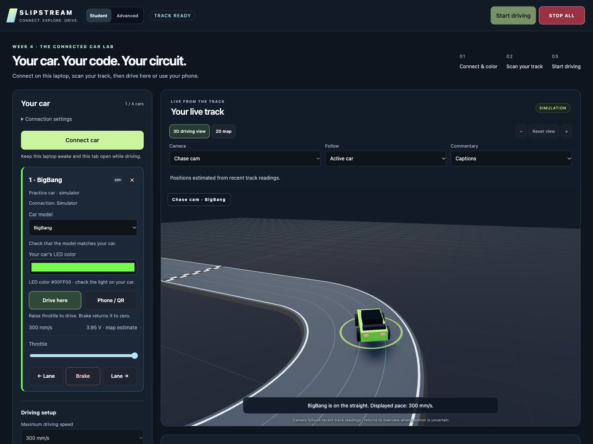
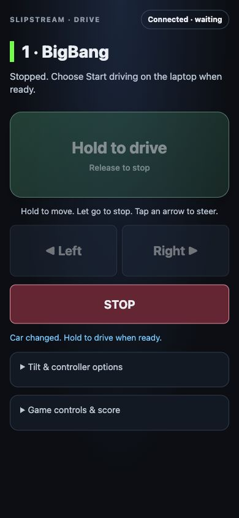

# Week 4 build report — 18 November 2026

Base: `da2ba34`, latest `origin/slipstream-and-security-hardening` when the new branch was created. Work branch: `week-4-student-driving`. No merge to main. Runtime trace identifier: `2026-11-18-week4-drive`.

## Validation

| Check | Baseline / final | Scope |
| --- | --- | --- |
| Node 22.23.5 full suite | 842/842 → 886/886|bench, platform, instructor-drive, Slipstream; 44 new checks|
| Python 3.14.7 unittest| 38/38 final|existing Python lab|
| Python CWE regression|pass|fixed authorization, replay and signed-profile probes|
| dependency lab|pass|fixed dependency probes; no network attempts|
| npm 11.9.0 audit|0 vulnerabilities|installed lockfile dependency graph|
| Browser simulator|pass|unique per-car QR without code, name/host approval, assigned-car phone hold/release,1200 maximum and2-second ramp, camera choices and responsive layout|

Tests use deterministic simulator or synthetic inputs. Camera tests use real Three.js scene objects with a stubbed drawing surface, plus actual WebGL visual inspection. They do not validate real Bluetooth timing, optical sensor behavior, sound output or physical stopping distance.

## Reproductions and changes

- Strict telemetry loss still reproduces a complete stop at 2 seconds; it is the existing policy rather than proof of a broken radio. Optional bounded recovery is covered by silent telemetry, late callbacks, queue stalls, STOP/recovery/link loss, optical reacquisition and mode/car-count regressions. Two ordinary readings are required; a packet alone is insufficient.
- Student maximum previously could not be selected and switching into Student silently clamped it to 300. Explicit stopped-only settings now retain the selected ceiling through workspace changes. An acceleration ramp reaches the requested target while reductions/STOP bypass it. Scans stay bounded.
- Student QR previously required the host code. Isolated anonymous room creation now supplies a distinct approved-car invitation. Tests cover four distinct stable invitations, revocation, late approvals, pending claims and refusal to select another car. Public creation has rate/capacity limits and an opt-out; deliberate room exhaustion remains possible.
- Exact piece 57 OBB extraction matched the existing table; no numeric geometry correction was warranted. The new optional rule is a Slipstream any-lane checkpoint, not a claim of stock F&F lane parity. Existing scored-round special-piece restrictions remain.
- Five camera views are presentation-only and require trusted position. Driver view has no chase lag or own-car obstruction. Followed-car identity lives in the HUD. Reduced motion and stale/off-track/ambiguous data revert to overview. Captions distinguish requested STOP, displayed pace and reported lap counts. Voice is opt-in and unsupported browsers retain captions.

## Evidence and limits

Read [Power Zone evidence](WEEK4-POWER-ZONE.md) and [car audio options](CAR-AUDIO-OPTIONS.md) for SDK/native addresses, artifact hashes, confirmed findings and unknowns. No proprietary audio, APK, OBB, firmware or decompiled function bodies were added. No physical vehicle was commanded during this build.

Guardian's prior accepted ordinary-track scan,3 forward laps, left/right shifts and 3-lap Computer round at 300mm/s remain the hardware baseline. Next physical acceptance should use Guardian, begin at that known pace, and change one option at a time: ramp, bounded recovery under observation, then custom Power Zone exit effect. Higher maximums are available, not hardware-endorsed. Never disable off-track/link/STOP checks to make a demo continue.

The audio investigation supports optional browser/phone playback. Spoken commentary is implemented; synthesized engine/effect sounds and an on-car audio retrofit are proposals, not completed features. No verified onboard sound opcode was found.

## Published verification

Implementation commit `748f645` was pushed and deployed to the existing Codespace on this branch. Its clean checkout and branch/head were verified. The managed live-only server restarted after the host page showed zero cars and STOPPED; no port visibility/access setting changed. The checkout completed despite the Codespace’s pre-existing missing Git LFS post-checkout hook warning; the hook was not removed.

Anonymous public readiness/controller checks passed and teaching routes stayed isolated. Through the actual public HTTPS address, a fresh Student room was created without a host code, four distinct per-car invitations were generated, and the temporary room was deleted. The published browser loaded the Week 4 controls without console warnings/errors and was left stopped with zero cars. Phone hold/release and camera rendering were checked on the local simulator; a real phone on the classroom network and physical acceptance remain separate checks.

## Visual previews

Simulator only; no physical acceptance is implied.

